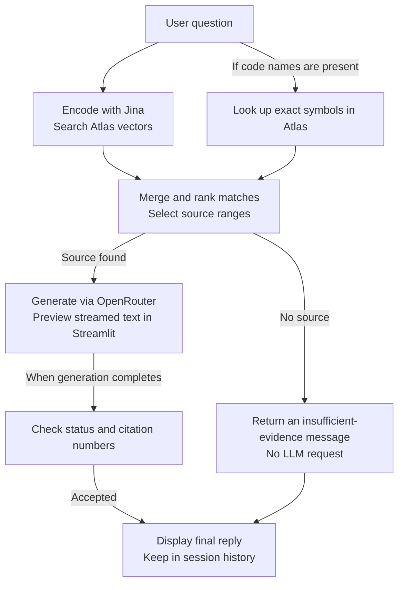
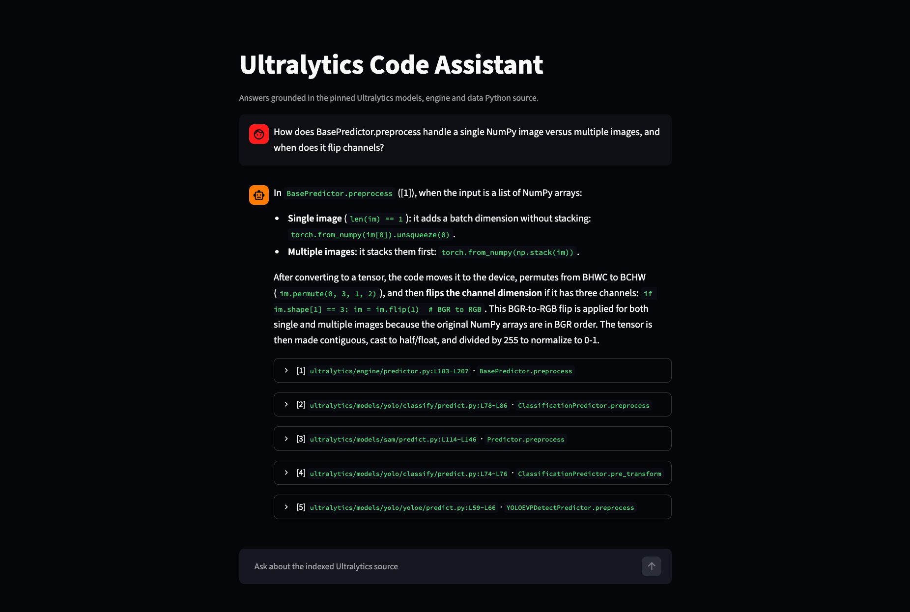

# Ultralytics Code Assistant

A source-grounded Q&A system for Ultralytics YOLO that combines AST-guided Python chunking, code embeddings and exact symbol lookup in MongoDB Atlas. Retrieved source supplies the evidence for OpenRouter explanations, with file-and-line citations tied to a fixed repository revision. The retrieval and answer-validation pipeline is implemented directly in Python, using uv, SentenceTransformers and Streamlit, without a pre-built RAG framework.

## Run

Install Python 3.11+, Git and [uv](https://docs.astral.sh/uv/), then open a terminal in this repository's root. Create a [MongoDB Atlas](https://www.mongodb.com/cloud/atlas/register) cluster supporting Vector Search, give a database user read/write and search-index permissions, and allow your IP in Network Access. Obtain an OpenRouter API key.

```bash
uv sync --locked
cp .env.example .env
# Fill in MONGODB_URI and OPENROUTER_API_KEY in .env.
uv run --locked python scripts/fetch_source.py
HF_HOME=.hf-cache uv run --locked python scripts/index_source.py
HF_HOME=.hf-cache uv run --locked streamlit run app.py
```

The indexer creates the Atlas collection and search index, indexing **104 Python files into 1,812 chunks**. The first build automatically downloads the embedding model. Open Streamlit's printed Local URL, normally `http://localhost:8501`, and check the indexed count in the sidebar before asking a question.

If Hugging Face downloads stall, retry with `HF_HUB_DISABLE_XET=1`. For Atlas connection errors, check the URI, database-user permissions and IP allowlist. Restart Streamlit after changing `.env`.

## Design decisions

### Source and application flow

The source is pinned to Ultralytics commit [`3d75949c41f78a2c6763eb347ac7a94793098e89`](https://github.com/ultralytics/ultralytics/tree/3d75949c41f78a2c6763eb347ac7a94793098e89), covering Python files in `ultralytics/models/`, `ultralytics/engine/` and `ultralytics/data/`. The downloader checks this revision and rejects edited source.

**Build the source index:**


**Answer a question:**



### How is code split, and why?

Python's `ast` identifies definitions; chunk text is sliced from the original file, preserving indentation, comments and line numbers.

- Short functions and methods stay whole. Long ones prefer boundaries after outer-level statements such as `if` or `for`, then fall back to complete source lines; large nested statements are not recursively split by syntax.
- Class declarations, decorators, docstrings, attributes and comments outside methods become `class_context` chunks. Methods and nested classes are indexed separately.
- Imports, constants and other module code are stored outside definition bodies. Nested functions remain inside their enclosing function's text.
- Syntax errors fall back to windows of at most 60 lines, still subject to the token budget.

The indexer targets **700 tokens including headers**, checks with the real tokenizer, and re-splits when estimation fails or a piece exceeds 800 tokens; source chunks over 1,024 are rejected. If one complete line still cannot fit, indexing stops with its file and line number to preserve accurate citations.

A coverage review found that method-only indexing omitted attributes such as [`RTDETRPredictor.scale_fill = True`](https://github.com/ultralytics/ultralytics/blob/3d75949c41f78a2c6763eb347ac7a94793098e89/ultralytics/models/rtdetr/predict.py#L33); storing class context fixed that omission.

| Decision | Benefit | Trade-off |
| --- | --- | --- |
| Store original source with definition names | Results can be inspected and linked back to the pinned file | A piece of a long method may omit the condition or call needed to explain it |
| Separate methods from class context | Attributes and inheritance are searchable without repeatedly storing all method bodies | A question about both may require multiple results |
| Add file, symbol and signature to embedding input | Gives a fragment its identity when its declaration is in another piece | Consumes input capacity; compare retrieval with and without headers to measure the benefit |
| Select at most five nonoverlapping file/line ranges | Bounds answer input and avoids repeated ranges | Relevant pieces below the cutoff can be left out |

### What metadata is stored?

| Fields | Purpose |
| --- | --- |
| `_id` | Replace chunks on rebuild and remove obsolete pieces |
| `repo_id`, `source_revision`, `embedding_model` | Restrict searches to the matching source and encoder |
| `file_path`, `symbol_full`, `symbol_short`, `symbol_type` | Identify the file, qualified/short name and kind; support name lookup |
| `start_line`, `end_line`, `part` | Locate the original text and distinguish split pieces |
| `file_sha256` | Detect source changes |
| `content` | Original source supplied to the answer model |
| `embedding_text`, `embedding` | Search input and its vector |

Every embedding input starts with `File`, `Symbol` and `Type`. Function/method pieces also receive a source-derived `Signature`, normalized onto one line and capped at **350 characters**; other piece types omit it.

```text
File: ultralytics/models/rtdetr/predict.py
Symbol: RTDETRPredictor.postprocess
Type: method
Signature: def postprocess(self, preds, img, orig_imgs):

<original source piece>
```

The generator receives original `content`, source ranges and symbol names. A per-file record tracks source hash/revision, encoder, chunking version and chunk IDs. Unchanged files are skipped only if their recorded chunks still exist; changed or incomplete files are rebuilt. To rebuild all files and regenerate their embeddings:

```bash
HF_HOME=.hf-cache uv run --locked python scripts/index_source.py --force
```

### Retrieval and answer checks

Questions and code use the same pinned encoder, normalized 768-dimensional vectors and Atlas cosine similarity. Searches filter by repository, source revision and embedding model; changing encoders requires re-embedding the source and using a compatible index. Questions beyond the encoder's 1,024-token limit are truncated.

1. **Find candidates:** retrieve 12 vector matches; for up to three identifiers such as `BaseDataset.load_image`, also look up up to five name matches each. Plain prose uses vector search.
2. **Combine and order:** deduplicate name results, then use reciprocal rank fusion to give higher-ranked matches more weight and add their weights when a piece appears in both lists; keep up to 15 distinct candidates. An explicit class-and-method name matching exactly one piece puts that piece first.
3. **Select source:** accept up to five valid, nonoverlapping ranges within a **2,600-token** source budget, counted with Jina's tokenizer on code only, excluding the question, system prompt and reference headers. If a piece is shortened, retain complete lines and update its citation to match.
4. **Prepare the answer input:** arrange pieces of the same definition in source order and join adjacent pieces for readability. This step reads no additional source.

A candidate found in step 1 can be excluded in step 3. Displayed chat history is not sent to the model; each question uses its own selected source and references link to the pinned commit.

The model is asked to start with `STATUS: ANSWERED` or `STATUS: INSUFFICIENT_EVIDENCE` and cite key claims. Missing or unknown status still displays the response text; empty answers, invalid reference numbers, answered responses without citations and truncated/API responses produce errors. Manual review checks whether the cited code supports each factual claim.

### Why these models?

**Embedding: `jinaai/jina-embeddings-v2-base-code`.** Research covered **Text-to-Code**—a natural-language question finding source—and **Code-to-Code**—a code snippet finding related implementations.

[CoREB Tables 3 and 15](https://arxiv.org/html/2605.04615v2), release `v202603`, provide a common comparison across five programming languages including Python:

| Candidate | Text-to-Code nDCG@10 ↑ | Text-to-Code Recall@10 ↑ | Code-to-Code nDCG@10 ↑ | Python-query Code-to-Code nDCG@10 ↑ |
| --- | ---: | ---: | ---: | ---: |
| [C2LLM-7B](https://huggingface.co/codefuse-ai/C2LLM-7B) | **0.443** | **0.753** | 0.659 | 0.639 |
| [C2LLM-0.5B](https://huggingface.co/codefuse-ai/C2LLM-0.5B) | 0.430 | 0.716 | 0.656 | 0.652 |
| [Jina Code Embeddings 1.5B](https://huggingface.co/jinaai/jina-code-embeddings-1.5b) | 0.414 | 0.705 | 0.671 | 0.688 |
| [Jina Code Embeddings 0.5B](https://huggingface.co/jinaai/jina-code-embeddings-0.5b) | 0.386 | 0.650 | **0.677** | **0.690** |
| [Qwen3-Embedding-4B](https://huggingface.co/Qwen/Qwen3-Embedding-4B) | 0.390 | 0.626 | 0.392 | 0.498 |
| [Qwen3-Embedding-8B](https://huggingface.co/Qwen/Qwen3-Embedding-8B) | 0.328 | 0.521 | 0.320 | 0.446 |

nDCG@10 measures how relevant and well ordered the first ten results are; Recall@10 measures how much relevant code they contain. Among these candidates, C2LLM leads Text-to-Code and newer Jina leads Code-to-Code; the final column isolates Python queries for equivalent-code retrieval. The [release leaderboard](https://hq-bench.github.io/coreb-page/), [MTEB-Code report](https://arxiv.org/html/2512.21332v1) and [leaderboard](https://mteb-leaderboard.hf.space/benchmark/MTEB%28Code%2C%20v1%29) and [Jina's task-specific model card](https://huggingface.co/jinaai/jina-code-embeddings-1.5b) support this shortlist.

**First, choose model sizes that fit the local machine.** Local memory constraints motivated testing C2LLM-0.5B instead of C2LLM-7B and including the older [161M-parameter Jina embeddings v2 base code](https://huggingface.co/jinaai/jina-embeddings-v2-base-code), trained on code/question and code/docstring pairs, as a lightweight candidate.

**Next, check commercial-use licensing.** Newer Jina Code Embeddings [0.5B](https://huggingface.co/jinaai/jina-code-embeddings-0.5b) and [1.5B](https://huggingface.co/jinaai/jina-code-embeddings-1.5b) use CC BY-NC 4.0, which does not grant commercial-use rights. Both [C2LLM-0.5B](https://huggingface.co/codefuse-ai/C2LLM-0.5B) and the older Jina model use Apache-2.0, so these became the two candidates for the repository test.

**Then, compare retrieval on this repository.** Each model was indexed in Atlas and tested on the same **14 answerable questions**, using the same pinned source, required-line labels, chunking rules and final five-range/2,600-token limits. Each model used its own tokenizer, producing 1,812 Jina chunks and 1,749 C2LLM chunks. Both preserved every nonempty source line; this check used retrieval only, with no LLM calls.

| Repository configuration | All required code selected | Partial | Target method missed |
| --- | ---: | ---: | ---: |
| **Jina embeddings v2 base code** | **12/14** | 1/14 | 1/14 |
| C2LLM-0.5B | 9/14 | 4/14 | 1/14 |

**Jina was selected because it supplied complete evidence for more repository questions.** C2LLM retrieved `collate_fn`, which Jina missed, but missed `DetectionTrainer.build_dataset`. The [comparison records](evaluation/embedding-comparison.json) preserve model revisions, integrity checks and selected source ranges; the default Jina configuration is pinned in [.env.example](.env.example).

**Generation: `dots-studio/dots-3-note-preview:free`.** A survey of free OpenRouter endpoints for code explanation and software-engineering tasks used the following public benchmark results to shortlist two candidates:

| Candidate | Public evidence | Relevance |
| --- | --- | --- |
| [Laguna S 2.1](https://huggingface.co/poolside/Laguna-S-2.1) | SWE Atlas Codebase QnA **46.2%**; SWE-bench Pro **59.4%** | Repository Q&A directly tests explanations of existing code |
| [Dots3-Note Preview](https://huggingface.co/dots-studio/dots3-note-prev/discussions/5) | SWE-bench Pro **61.0%**; LiveCodeBench v6 **91.5%** | Strong software-engineering and code-reasoning results |

Laguna's Q&A figure is [Poolside's evaluation](https://poolside.ai/blog/introducing-laguna-s-2-1) using [SWE Atlas](https://labs.scale.com/leaderboard/sweatlas-qna); Dots' figures are reported in its model-card charts. Both were then compared on three English project questions, three repetitions each, with identical retrieved source and prompts, temperature 0 and reasoning disabled. All 18 requests are saved in [llm-comparison.json](evaluation/llm-comparison.json).

| Measured outcome | Laguna S 2.1 | Dots3-Note Preview |
| --- | ---: | ---: |
| Complete responses | 4/9; five HTTP 429s | 9/9 |
| Median time to first text | 1.17s | 1.67s |
| Median time to complete response | 12.15s | 7.76s |
| Observed output delivery | 45.61 tokens/s | 71.65 tokens/s |

Timings compare the four matching pairs with complete responses from both models, excluding retrieval. Tokens/s includes network delivery and each model's token accounting. The UI previews streamed text and validates the completed response before saving it to chat history. Saved format-check outcomes predate the current display fallback.

**Dots was selected for more consistent response availability and faster completion; Laguna delivered first text sooner.** Runtime uses one attempt, reasoning disabled, a 2,000-token output limit and a 60-second timeout, with no automatic fallback. Change `OPENROUTER_MODEL` to use another supported free endpoint; [Laguna's free endpoint](https://openrouter.ai/poolside/laguna-s-2.1:free) announces retirement on October 31, 2026.

## Evaluation of the current version

**Source RAG needs three separate checks:**

1. **Indexing:** were all required source files and code preserved in Atlas?
2. **Retrieval:** did the code sent to the model include the evidence needed for this question?
3. **Generation:** did the answer interpret that evidence correctly and cite the supporting lines?

Fix indexing when source is missing from the database, retrieval when stored code is not selected, and generation when supplied code is misinterpreted.

Evaluation inputs and results:

| File | What it does |
| --- | --- |
| [questions.jsonl](evaluation/questions.jsonl) | Fourteen answerable retrieval questions and one explicit out-of-scope question. Positive labels specify the expected file/method and source lines needed for the question. |
| [results.json](evaluation/results.json) | Current source-integrity and retrieval results, with selected source, failure-diagnostic ranks and source/model revisions. |
| [embedding-comparison.json](evaluation/embedding-comparison.json) | Jina and C2LLM-0.5B tested on the same questions and retrieval rules, with source-integrity checks and per-question selected ranges. |
| [llm-comparison.json](evaluation/llm-comparison.json) | Two models, three questions and three trials each: all 18 raw responses or failures, frozen inputs, settings, token usage and streaming measurements. |

### Was the source stored completely?

| Directory | Python files | Nonempty source lines | Uncovered lines |
| --- | ---: | ---: | ---: |
| `ultralytics/models` | 85 | 18,792 | 0 |
| `ultralytics/engine` | 8 | 7,047 | 0 |
| `ultralytics/data` | 11 | 7,972 | 0 |
| **Total** | **104** | **33,811** | **0** |

All **104 target files** were chunked and stored. All **1,812 Atlas chunks** match the locally generated source and metadata, with no missing or extra IDs; the 104 per-file records also match. This confirms source preservation across the indexed scope.

### Did retrieval select enough code?

Of 14 answerable questions, **12 received all labelled source, one received part and one missed it**. The explicit out-of-scope question correctly returned no source.

| Question group | All labelled source selected | Partial | Miss |
| --- | ---: | ---: | ---: |
| Four questions triggering name lookup | 4 | 0 | 0 |
| Ten questions without name lookup | 8 | 1 | 1 |

The two incomplete cases are:

- **Miss — batch assembly:** `YOLODataset.collate_fn` is stored but absent from the top 50 vector results for the natural-language question. Naming it enables lookup; keyword retrieval is the next comparison.
- **Partial — image read and resize:** the relevant `load_image` pieces rank 5 and 7 in the 12 vector candidates. The final five-piece selection omits L298–321, containing resize and return logic.

These development questions label required source lines, allowing the same cases to compare different chunk boundaries. Unseen questions are planned for final validation.

The 161M-parameter encoder supplied complete evidence for 12 of 14 questions, while a free LLM produced the useful explanations in the demo examples below. These results are encouraging given the modest model configuration. This provides a practical baseline: separate source-preservation and retrieval checks expose chunking and selection failures, and the same evaluation can measure improvements from stronger models.

### Example questions and demo

Try the following five questions in Streamlit. They deliberately combine two questions naming specific methods with three natural-language questions containing no code names, covering both exact-name lookup and semantic retrieval across prediction, training and data preparation.

All five retrieved the main source needed, displayed successfully and correctly explained the requested behavior. Four answers had accurate supporting citations; the postprocessing answer had one reference pointing to the wrong piece of the same method.

1. How does BasePredictor.preprocess handle a single NumPy image versus multiple images, and when does it flip channels?
2. When layers are frozen during training, do all batch-normalization layers switch to evaluation mode, or only some?
3. How does DetectionPredictor.construct_result scale boxes and create a Results object?
4. Where does the detection trainer build its dataset?
5. How are object-detection predictions postprocessed before the final results are returned?



Expand references to inspect the retrieved code, as shown in [source evidence](assets/source-evidence.png).

## Limits and future work

### Any critical missing features?

- **Retrieve all source needed to explain a behavior.** The retrieval failures above show two gaps: finding methods from natural-language questions and selecting all required parts of long methods. Next steps address these through keyword retrieval, reranking and reading missing pieces within the source budget.
- **Reliable generation with the current model.** `dots-studio/dots-3-note-preview:free` occasionally misreads supplied conditions, omits status headers or cites the wrong source piece despite sufficient evidence. Compare suitable replacements on identical source, balancing answer quality and instruction following with first-token latency, completion time, throughput, cost and endpoint availability; validate the chosen configuration through the full RAG before adoption.

### What could be improved with more time?

Research suggests a practical sequence: **find a relevant location, read the source needed to explain it, then check the answer against that source.** The following experiments would compare these methods against the current implementation on this repository.

#### Next steps

**Establish a shared baseline.** Keep the current system as the baseline and extend its evaluation set with more human-reviewed answers. Compare changes using the same questions, source revision and input budget, measuring source coverage, answer correctness, whether each cited excerpt supports its claim, and response time. Label required file/line ranges so questions remain comparable across chunkers, and reserve unseen questions for final validation.

**1. Read the missing part of a method already found.** The `load_image` case supplies one part but omits conditions and return logic elsewhere in the method. Following [LC²'s separation of retrieval and comprehension contexts](https://aclanthology.org/2026.acl-short.64/), retrieve other pieces matching the selected method's file, full name and revision within the five-range/2,600-token limits. Check whether this supplies the missing lines and improves the explanation.

**2. Add keyword retrieval for methods vector search misses.** `collate_fn` is missing from the vector results despite a docstring describing “data samples into batches”. Following the multiple-search approach explored in [CodeRAG](https://arxiv.org/html/2509.16112v1), try BM25 over names, docstrings and code, combining 12 keyword and 12 vector results with exact-name matches. Apply the same final selection and compare required-source coverage and latency.

**3. Rerank candidates before choosing the final five.** The `load_image` piece at rank 7 illustrates a different problem: relevant code is already among the candidates. Test a [cross-encoder](https://sbert.net/examples/applications/retrieve_rerank/README.html) scoring the question with each candidate's path, name and code, then reorder the same up-to-15 candidates. Compare which required lines reach the generator and the added latency.

**4. Compare chunk boundaries if gaps remain.** [cAST](https://aclanthology.org/2025.findings-emnlp.430/) and a [controlled chunking study](https://arxiv.org/html/2605.04763v1) suggest structural and sliding-window alternatives to test. Use separate indexes with identical embeddings and headers; first retain the current five-range/2,600-token limits, then keep the token budget but remove the five-range cutoff. Compare required-source coverage, accurate citations, duplication and indexing cost to distinguish better boundaries from simply admitting more pieces.

**5. Separate evidence classification from answer writing.** A demo response omitted the required status; test [Jev](https://docs.typesafe.ai/primitives) on the question and retrieved code to classify evidence as sufficient, partial or insufficient. The application would set the status and the LLM would write the explanation. Measure how often it labels missing evidence as sufficient or rejects sufficient evidence, plus added latency and cost.

#### Medium to long term

**Compare larger embeddings under suitable deployment conditions.** Use the tested Jina configuration as the baseline. With more compute and appropriate usage rights, compare C2LLM-7B and Jina Code Embeddings 1.5B on identical chunks/questions, measuring Recall@10, nDCG@10, required-source coverage, memory and query latency.

**Trace calls and inheritance across files using a code graph.** A previous answer used `ClassificationPredictor.pre_transform` to explain base-predictor behavior. First determine what object `self` represents, then find its actual `pre_transform`, including subclass overrides. Following [LocAgent](https://arxiv.org/html/2503.09089v2), represent files, classes and methods as graph nodes, linked by imports, calls and inheritance. From a retrieved method, fetch source for its callers, the functions it calls or its parent-class implementation, as the question requires; initially follow one link. State when Python's dynamic behavior prevents resolving the target. Compare required-source coverage, answer correctness, latency and graph-update cost against the baseline; extend indexing to `nn` or `utils` when needed.

**Explore class-level navigation.** For questions spanning methods, such as loading images and assembling batches, first search a short list of class names and method signatures, then fetch the matching original implementations. Compare source coverage and update cost before introducing generated descriptions.

### How would this scale to production?

**Choose models by quality, user experience and cost.** Compare lightweight Claude and OpenAI models with Kimi and DeepSeek, including moderate or higher reasoning settings where supported. First supply identical source to isolate generation, then test the complete RAG on unseen method and cross-file questions. Measure factual/citation correctness, first-content and complete-answer p95 latency (95% finish within that time), acceptable answers per second under concurrent load, and cost per acceptable answer including failures. Choose the least costly configuration meeting quality and speed requirements; improve missing evidence before escalating generation.

**Check retrieved evidence and answers before release.** Replay human-reviewed questions through the full RAG, checking required source, answer conditions and supporting citations. Block changes that break previously correct answers or lose required code. Sample live failures, identify whether indexing, retrieval or generation caused them, and add confirmed cases to regression tests.

**Recover from service failures within a fixed budget.** The five HTTP 429s motivate testing [LiteLLM routing and fallback](https://docs.litellm.ai/docs/routing) with primary and backup configurations that pass the same answer tests. Set one overall deadline and retry budget; switch on timeouts/rate limits and temporarily stop using repeatedly failing endpoints. Test forced failures, checking answer quality, citations and the actual serving model after recovery.

**Update source and models safely.** Build incremental indexes in a background job and verify a new collection before switching traffic. Keep the previous collection and its matching query encoder for rollback, and retain answer links to their original source revision. Run source-preservation and citation-format tests in CI, plus a budgeted retrieval/answer suite before releases; record source, encoder and prompt/model versions together for reproducibility.

**Make answers accurate and dependable enough for production use.** Compare clearer instructions and examples pairing code with correct explanations, keeping the model, source and questions fixed. If recurring errors remain, train with human-corrected question–source–answer pairs using supervised fine-tuning (SFT). Compare against the best prompted baseline on unseen questions, measuring correctness, citation support and successful display; adopt tuning when the improvement justifies its costs.
